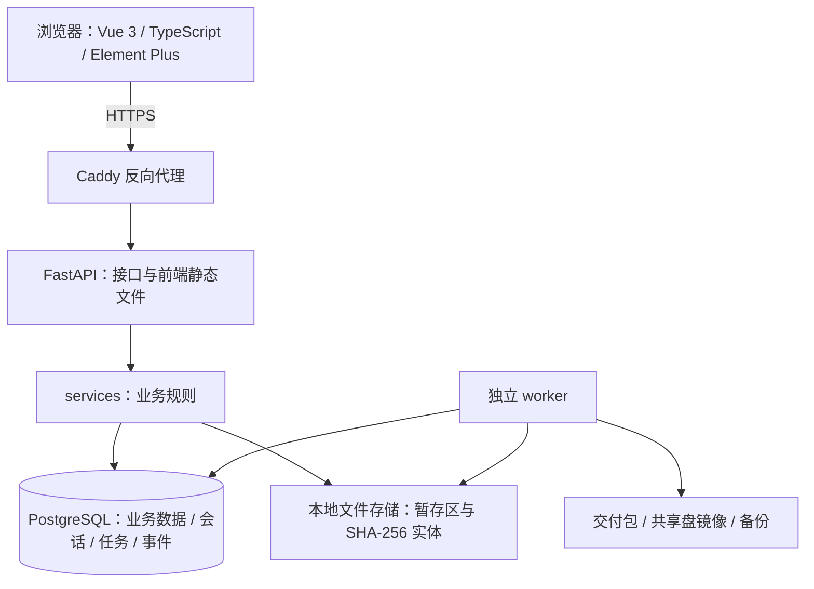
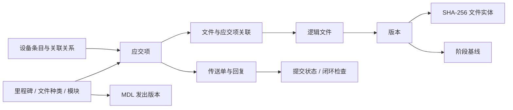

# docbase 架构与数据流

核对日期：2026-11-02。依据当前源码、数据库迁移和 PRD；实现情况与验收缺口见本文第 7、8 节。

## 1. 产品边界

docbase 是企业内网、单租户、多项目的工程文件管理平台，服务总包、设备交付和产线集成中的文控工作。主数据是项目结构和设备清单，由它们生成应交项，再关联文件、提交记录和客户回复，生成 MDL 与交付包。

当前第一版采用规则识别，不读取文件内容进行 AI 问答或审核；没有模型服务、向量数据库、审批引擎或 Procore/Jira 对接。项目文件夹名称中的 AI 不代表当前已有 AI 功能。

## 2. 运行架构

- 这是一个模块化单体：API 与 worker 复用同一套模型和业务服务；不需要微服务、Redis 或 Celery。
- Windows：`docbase-api`、`docbase-worker`、`docbase-proxy` 三个应用服务，另加 PostgreSQL 服务。试点优先使用此方式。
- Linux Compose：`api`、`worker`、`proxy`、`db` 四个容器。systemd 是 Ubuntu 24.04 的另一种交付方式。
- 生产前端由后端提供，无需启动 Vite；前端构建依赖已打入发布包。首次在线安装与应用运行的联网要求不同。
- 默认只部署一个 worker。数据库租约支持任务领取协调，但大文件长任务的多 worker 安全性仍需验证，不能据此承诺水平扩容。

## 3. 代码分层

| 位置 | 责任 | 关键入口 |
|---|---|---|
| `frontend/src/views`、`components` | 页面与交互；中文、英文走 i18n | `router/index.ts` 注册全部 12 个项目功能页 |
| `frontend/src/api`、`stores` | HTTP 调用、会话和项目上下文 | `api/http.ts`、`stores/user.ts` |
| `backend/app/api` | 请求校验、权限入口、调用服务、提交事务 | `main.py`、`api/deps.py` |
| `backend/app/services` | 结构、应交项、上传、识别、MDL、交付等业务 | `structure.py`、`files.py`、`transmittals.py` |
| `backend/app/models.py`、`db.py` | ORM 数据模型与数据库会话 | Alembic 管理结构变更 |
| `backend/app/worker.py` | 领取任务、租约、进度、调度 | 导入、交付、镜像、清理、备份 |
| `backend/scripts` | 开发检查、备份恢复、用户创建和发布 | `check.py`、`release.py` |
| `deploy` | 操作系统服务、容器、代理与安装入口 | Windows `install.cmd` / `install.ps1` |

总体分层与 PRD 的轻量单体方向一致。业务服务有较完整的模块拆分，路由仍有查询和事务编排，不应把“薄路由”理解成所有路由完全没有业务处理。数据库字段详见 [数据库说明](database.md)。

## 4. 核心数据关系与业务流程

文件与应交项通过 `FileDeliverable` 关联，一份文件可覆盖多个应交项，一项也可有多个文件。按设备的应交项按设备条目生成，不按台数展开；无设备、无模块分区时，每个文件种类一个应交项。

1. 文控维护结构、设备与关联关系，系统生成应交项。
2. 文件先进入暂存区，规则识别器给出位置与命名预览，人工确认后入库。
3. 文件入库只改变收集情况，不等于提交给客户。传送单与客户回复驱动提交状态。
4. MDL 输出平台主数据；只导回平台格式中的允许字段，不自动理解任意客户 MDL。
5. 基线冻结版本引用，交付任务生成 zip，镜像按事件更新。

## 5. 一致性、权限和运维边界

**文件与事务。** `storage.py` 先写暂存、校验哈希，再移动到实体目录；数据库事务失败可能留下未引用实体，worker 延迟清理。文件系统与 PostgreSQL 不是同一个原子事务，突然断电、磁盘损坏仍要通过故障演练与备份恢复验证。版本的内容引用保留，显示文件名可以随配置变化，不等于所有版本字段永远不会更新。

**任务与事件。** 业务变更与 Outbox 事件在数据库事务内写入；worker 使用任务表、60 秒租约和续租。导入逐项保存进度；交付包中断后重新生成 `.part`，完成后改名。普通异常会记录任务失败，不等于所有失败都会无限自动重试。

**权限。** 认证入口与 `services/access.py` 统一控制接口权限，角色是全局数据，成员角色按项目分配。当前项目成员可查看本项目文件，尚未启用按文件种类或供应商隔离。文件下载需要登录权限；共享盘镜像使用操作系统共享权限，不继承应用内成员权限。

**审计。** 业务修改记录字段差异；没有普通业务操作可以任意改删审计。删除空项目是明确例外：清理其历史并保留项目外删除摘要。这不是防数据库管理员篡改的不可变审计存储。

**运行状态。** `/api/health` 检查数据库连通和存储可写，不直接证明 worker 消费正常、备份完整或所有文件哈希正确。任务排队、备份清单及恢复演练需要单独检查。

## 6. 架构评估

现有架构适合继续完成单机试点，不必为了第一版引入额外基础设施。当前主要缺口在可靠性边界和实际容量验证：

- `backup.py` 将找不到的实体记入 `missing` 后仍设置 `last_ok`；`system.py` 没有据此判为异常。应补充缺失文件失败判定及恢复演练，当前不能只凭“最近成功”认定备份完整。
- 长任务的续租发生在处理项之间，交付每 20 个文件续租，备份处理函数没有周期性续租；慢盘或大文件可能超过租约。启用多个 worker 前需改进或验证此行为。
- 存储检查依据目录和写入探测，没有独立挂载身份校验。Linux/NAS 挂载消失但挂载点仍可写时，需要验证是否会误写系统盘。
- 硬链接镜像依赖 IT 配置只读共享，否则修改镜像可能修改原实体。镜像不是独立备份。
- 大项目查询、整项目快照和浏览器矩阵的开销需要用真实规模测量；现有测试文件存在不等于 20 人并发、80 GB 导入已达标。

上述问题为代码审查发现或待验证风险，本次文档整理没有修改其业务实现。先处理可靠性缺口，再在隔离验收环境完成业务流程、真实容量与故障演练。

## 7. PRD 功能与代码对应

以下“有实现”指已核对页面、接口、服务和测试位置，不表示本轮已跑完这些测试或真实项目验收。

| PRD | 当前实现与效果 | 主要服务 / 测试文件 | 边界 |
|---|---|---|---|
| F1 项目 | 新建、成员、汇总、归档；可删除空项目 | `projects.py`、`project_delete.py` / `test_project_list.py`、`test_projects_api.py` | 删除空项目会清理历史，另留摘要 |
| F2 结构 | 里程碑、种类、模块、粘贴、复制、标准模板；要求类别与 MDL 版本 | `structure.py`、`structure_template.py`、`mdl_versions.py` / `test_structure.py`、`test_mdl_versions.py` | 不导入任意客户 MDL；配置可变不等于无需初始化 |
| F3 设备 | Excel 映射、预览确认、条目与台数、历史恢复、删除/停用 | `equipment.py`、`equipment_import.py`、`usage.py` / `test_equipment.py`、`test_usage.py` | 最近发出 MDL 时已存在的设备/模块受删除限制 |
| F4–F5 存文件 | 指定位置上传、规则投递、待归类、命名、升版、2 GB 上限和分块接口 | `files.py`、`naming.py`、`recognizer.py`、`storage.py` / `test_files.py`、`test_drop.py`、`test_naming.py` | 大文件速度、识别正确率仍待实测 |
| F6 浏览 | 三种视图、元数据搜索、PDF/图片/文本预览、下载 | `browse.py` / `test_browse.py` | 无文件内容全文搜索，无 Office/CAD 在线编辑 |
| F7 矩阵与 MDL | 收集与提交分开统计；Excel/PDF、平台格式导回、客户回复、关闭检查 | `deliverable_query.py`、`mdl_export.py`、`transmittals.py`、`closeout.py` / 对应 `test_*.py` | 下载传送单/MDL 不会代发邮件；客户数据需人工确认 |
| F8 交付 | 后台 zip、共享盘镜像、基线快照与对比 | `delivery.py`、`mirror.py`、`baselines.py` / `test_delivery.py` | 镜像权限由 IT 设置；同步一分钟是验收目标 |
| F9 存量导入 | 扫描、去重、报告调整、执行、暂停、有限撤销 | `importer.py`、`worker.py` / `test_import.py`、`test_worker.py` | 撤销跳过已提交或后续升版的文件；未证实 80 GB 达标 |
| F10 权限审计 | 本地账号、项目角色、接口权限、字段变更记录 | `auth.py`、`access.py`、`history.py` / `test_access.py`、`test_history.py` | 未接 AD/LDAP/OIDC；不是防篡改审计系统 |
| 运维 | Windows 自动安装、Linux 两种入口、迁移、备份恢复、健康检查 | `deploy/`、`scripts/` / `test_deploy.py`、`test_ops.py` | 实际环境验证范围见下一节 |

服务位于 `backend/app/services/`，测试位于 `backend/tests/`。前端 12 个项目功能页均已绑定实际组件，没有项目菜单仍指向占位页；这不代表所有交互均已重新验收。

## 8. PRD 验收状态

| # | 目标 | 已有依据 | 尚需取得的验收结果 |
|---|---|---|---|
| 1 | 结构与试点 MDL 一致，编号不混淆 | 结构/编号测试与页面实现 | 人工核对试点完整结构 |
| 2 | MDL 导出和导回正确 | Excel/PDF、差异确认实现与测试 | 客户实际使用格式及往返核对 |
| 3 | 200+ 设备无遗漏、附加属性完整 | 设备映射与历史恢复测试 | 完整清单导入核对 |
| 4 | 80 GB 导入、正确归档率 ≥90% | 规则识别和导入任务实现 | 真实数据全量导入；随机抽查 200 个文件，记录正确、错误和待归类 |
| 5 | 两种上传；<150 MB 在 1 分钟内归档 | 上传/命名/分块测试 | 指定硬件、网络、文件大小的实测耗时 |
| 6 | 最新 3 版、客户与引用版本保护 | 保留和清理测试 | 在隔离验收库演示 V1–V4 与保护例外 |
| 7 | 缺件、逾期、完成率正确 | 统一查询口径及测试 | 与人工台账核对，区分收集和提交 |
| 8 | 交付包正确、镜像一分钟内更新 | 打包、镜像、基线实现 | 对文件数/哈希；慢盘、积压和共享权限实测 |
| 9 | 20 人并发，列表/矩阵 ≤2 秒 | 有页面与查询实现 | 固定数据规模下并发压测，报告超时和耗时 |
| 10 | 拔盘、异常关机、重启后恢复 | 存储错误和任务租约测试 | 隔离环境故障注入；验证挂载身份、续租及数据一致性 |
| 11 | 新客户配置化部署、Linux、升级不丢数据 | 安装脚本、CI 定义；Windows 本机安装记录 | 新电脑、局域网、真实跨版本升级；对应提交的 Linux CI 结果 |

历史本机验证包括 HTTPS、登录、冒烟项目读写与归档、空业务文件集的备份恢复。不能外推为大文件恢复、其他电脑或所有 PRD 指标通过。本机过程日志不作为公开产品文档发布。

本轮为代码与文档核对，没有向正式库写验收数据。完整数据库回归、浏览器端到端、压力及断电测试未在本轮执行。
