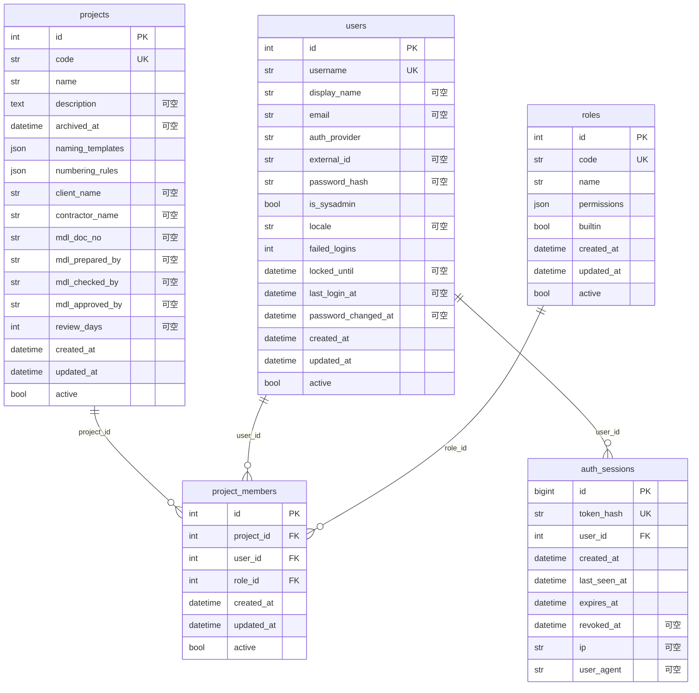
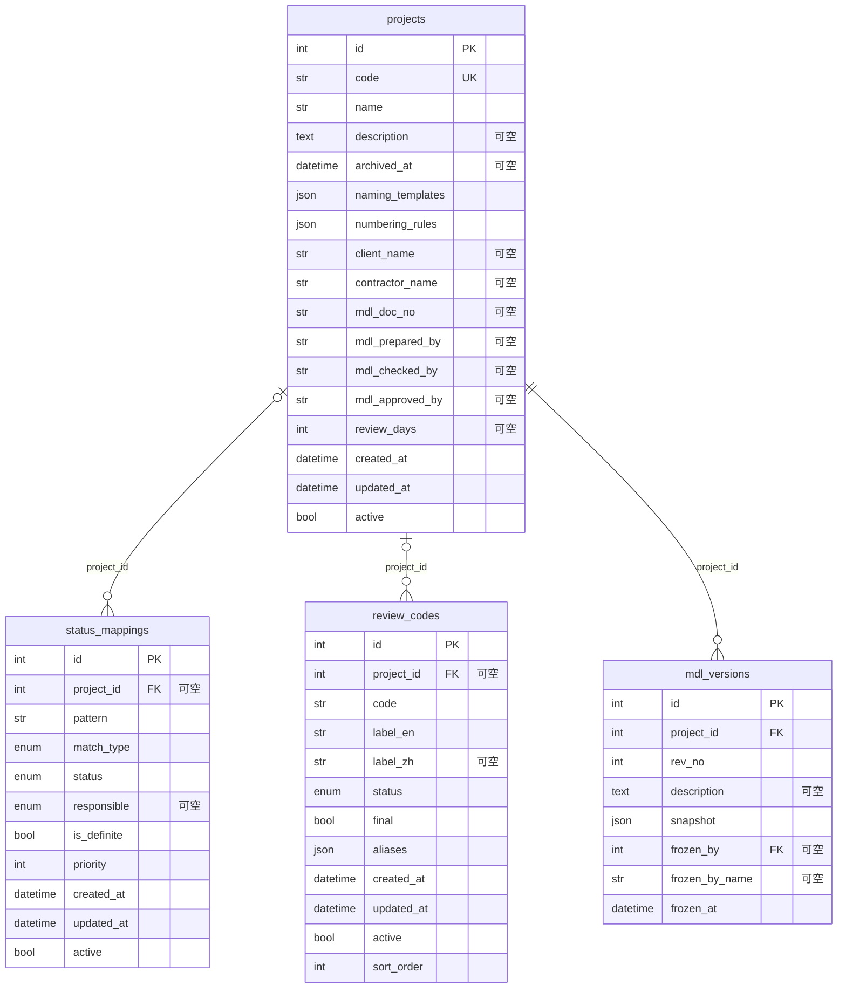
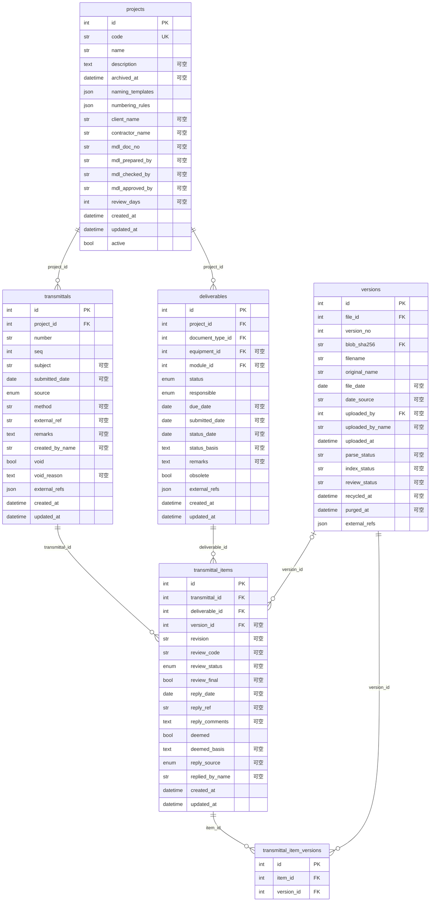
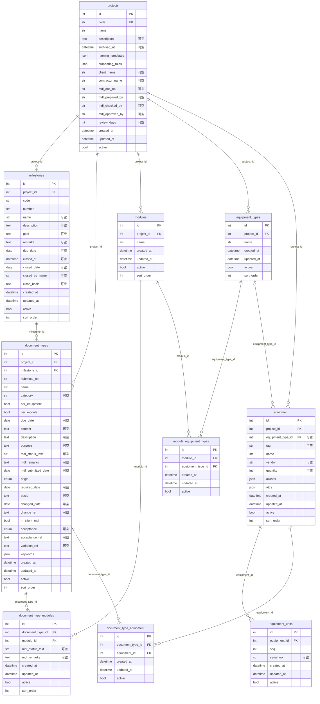
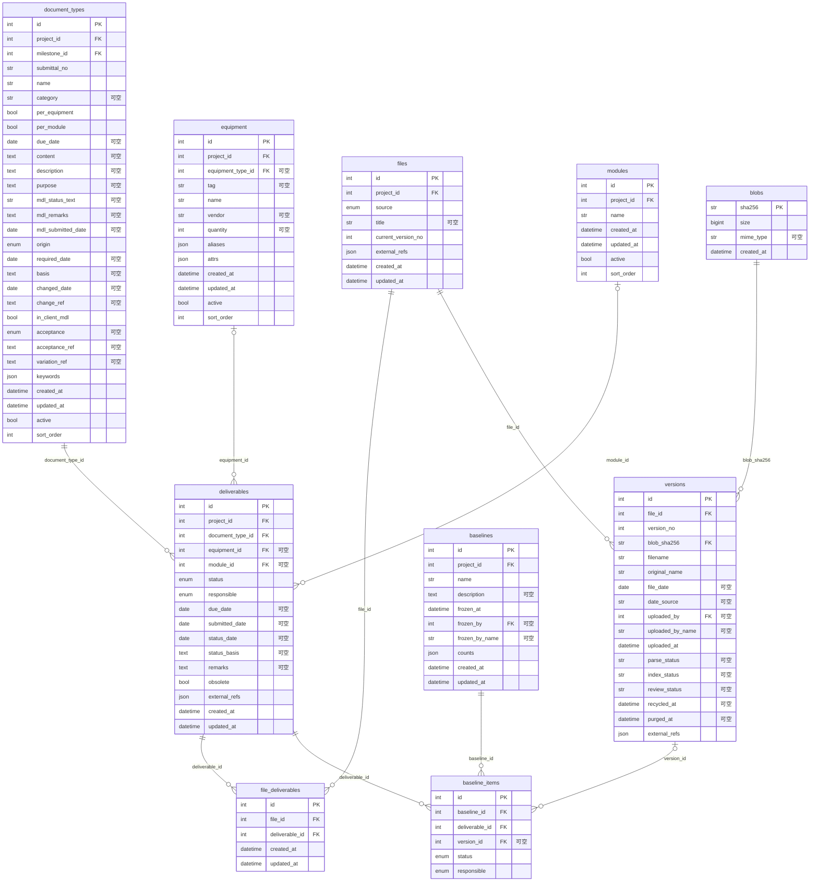
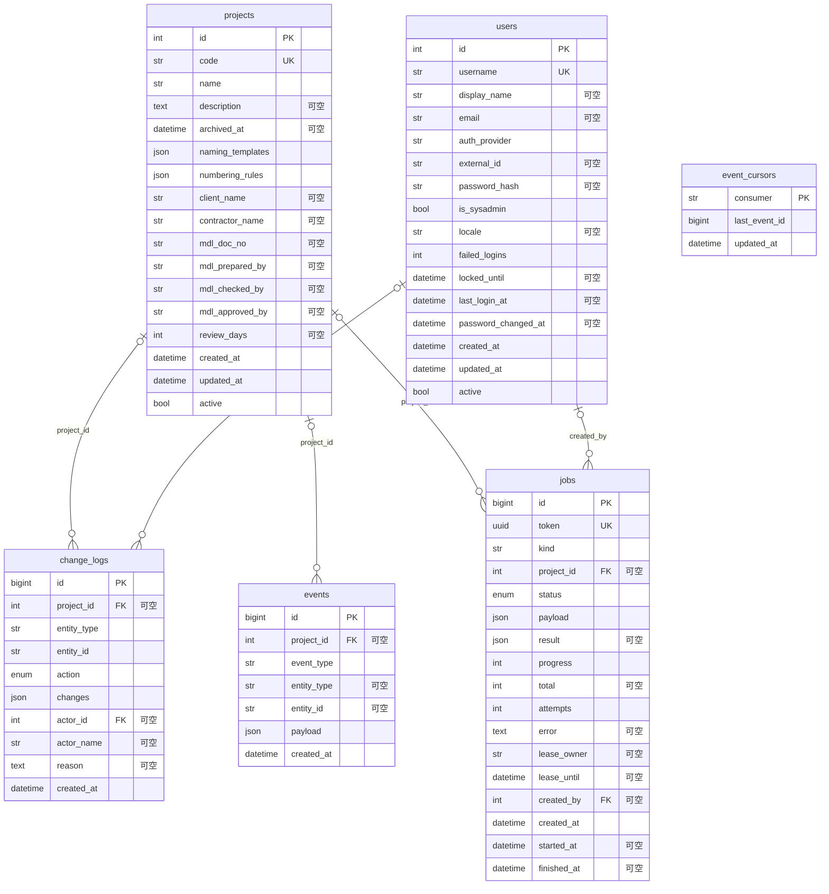
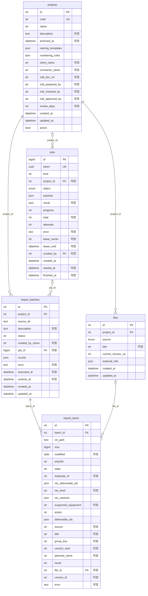

# 数据库关系图

> 本文件由 `backend/scripts/gen_erd.py` 从 `app/models.py` 自动生成，**不要手改**。
> 字段说明见 [database.md](database.md)。
>
> 查看方式：VS Code 里用 Markdown Preview Enhanced 打开预览（右键 → Markdown Preview Enhanced: Open Preview），或在 GitHub 上直接查看。

图例：`PK` 主键 · `FK` 外键 · `UK` 唯一 · `||--o{` 一对多（必填） · `|o--o{` 一对多（可空）；连线上的文字是外键字段名。

## 账号与权限

## 项目配置

## 提交与客户审核

## MDL 结构与设备

## 应交、文件与基线

## 系统（变更记录、事件、任务）

## 存量导入

## 全部表（总图）

```mermaid
erDiagram
    auth_sessions {
        bigint id PK
        str token_hash UK
        int user_id FK
        datetime created_at
        datetime last_seen_at
        datetime expires_at
        datetime revoked_at "可空"
        str ip "可空"
        str user_agent "可空"
    }
    baseline_items {
        int id PK
        int baseline_id FK
        int deliverable_id FK
        int version_id FK "可空"
        enum status
        enum responsible
    }
    baselines {
        int id PK
        int project_id FK
        str name
        text description "可空"
        datetime frozen_at
        int frozen_by FK "可空"
        str frozen_by_name "可空"
        json counts
        datetime created_at
        datetime updated_at
    }
    blobs {
        str sha256 PK
        bigint size
        str mime_type "可空"
        datetime created_at
    }
    change_logs {
        bigint id PK
        int project_id FK "可空"
        str entity_type
        str entity_id
        enum action
        json changes
        int actor_id FK "可空"
        str actor_name "可空"
        text reason "可空"
        datetime created_at
    }
    deliverables {
        int id PK
        int project_id FK
        int document_type_id FK
        int equipment_id FK "可空"
        int module_id FK "可空"
        enum status
        enum responsible
        date due_date "可空"
        date submitted_date "可空"
        date status_date "可空"
        text status_basis "可空"
        text remarks "可空"
        bool obsolete
        json external_refs
        datetime created_at
        datetime updated_at
    }
    document_type_equipment {
        int id PK
        int document_type_id FK
        int equipment_id FK
        datetime created_at
        datetime updated_at
        bool active
    }
    document_type_modules {
        int id PK
        int document_type_id FK
        int module_id FK
        str mdl_status_text "可空"
        text mdl_remarks "可空"
        datetime created_at
        datetime updated_at
        bool active
        int sort_order
    }
    document_types {
        int id PK
        int project_id FK
        int milestone_id FK
        str submittal_no
        str name
        str category "可空"
        bool per_equipment
        bool per_module
        date due_date "可空"
        text content "可空"
        text description "可空"
        text purpose "可空"
        str mdl_status_text "可空"
        text mdl_remarks "可空"
        date mdl_submitted_date "可空"
        enum origin
        date required_date "可空"
        text basis "可空"
        date changed_date "可空"
        text change_ref "可空"
        bool in_client_mdl
        enum acceptance "可空"
        text acceptance_ref "可空"
        text variation_ref "可空"
        json keywords
        datetime created_at
        datetime updated_at
        bool active
        int sort_order
    }
    equipment {
        int id PK
        int project_id FK
        int equipment_type_id FK "可空"
        str tag "可空"
        str name
        str vendor "可空"
        int quantity "可空"
        json aliases
        json attrs
        datetime created_at
        datetime updated_at
        bool active
        int sort_order
    }
    equipment_types {
        int id PK
        int project_id FK
        str name
        datetime created_at
        datetime updated_at
        bool active
        int sort_order
    }
    equipment_units {
        int id PK
        int equipment_id FK
        int seq
        str serial_no "可空"
        datetime created_at
        datetime updated_at
        bool active
    }
    event_cursors {
        str consumer PK
        bigint last_event_id
        datetime updated_at
    }
    events {
        bigint id PK
        int project_id FK "可空"
        str event_type
        str entity_type "可空"
        str entity_id "可空"
        json payload
        datetime created_at
    }
    file_deliverables {
        int id PK
        int file_id FK
        int deliverable_id FK
        datetime created_at
        datetime updated_at
    }
    files {
        int id PK
        int project_id FK
        enum source
        str title "可空"
        int current_version_no
        json external_refs
        datetime created_at
        datetime updated_at
    }
    import_batches {
        int id PK
        int project_id FK
        text source_dir
        text description "可空"
        str status
        str created_by_name "可空"
        bigint job_id FK "可空"
        json counts
        text error "可空"
        datetime executed_at "可空"
        datetime undone_at "可空"
        datetime created_at
        datetime updated_at
    }
    import_items {
        int id PK
        int batch_id FK
        text rel_path
        bigint size
        date modified "可空"
        str sha256
        str state
        int duplicate_of "可空"
        json rec_deliverable_ids
        str rec_level "可空"
        json rec_reasons
        str suspected_equipment "可空"
        str action
        json deliverable_ids
        str source "可空"
        str title "可空"
        str group_key "可空"
        int version_rank "可空"
        str planned_name "可空"
        str result
        int file_id FK "可空"
        int version_id "可空"
        text error "可空"
    }
    jobs {
        bigint id PK
        uuid token UK
        str kind
        int project_id FK "可空"
        enum status
        json payload
        json result "可空"
        int progress
        int total "可空"
        int attempts
        text error "可空"
        str lease_owner "可空"
        datetime lease_until "可空"
        int created_by FK "可空"
        datetime created_at
        datetime started_at "可空"
        datetime finished_at "可空"
    }
    mdl_versions {
        int id PK
        int project_id FK
        int rev_no
        text description "可空"
        json snapshot
        int frozen_by FK "可空"
        str frozen_by_name "可空"
        datetime frozen_at
    }
    milestones {
        int id PK
        int project_id FK
        str code
        str number
        str name "可空"
        text description "可空"
        text goal "可空"
        text remarks "可空"
        date due_date "可空"
        datetime closed_at "可空"
        date closed_date "可空"
        str closed_by_name "可空"
        text close_basis "可空"
        datetime created_at
        datetime updated_at
        bool active
        int sort_order
    }
    module_equipment_types {
        int id PK
        int module_id FK
        int equipment_type_id FK
        datetime created_at
        datetime updated_at
        bool active
    }
    modules {
        int id PK
        int project_id FK
        str name
        datetime created_at
        datetime updated_at
        bool active
        int sort_order
    }
    project_members {
        int id PK
        int project_id FK
        int user_id FK
        int role_id FK
        datetime created_at
        datetime updated_at
        bool active
    }
    projects {
        int id PK
        str code UK
        str name
        text description "可空"
        datetime archived_at "可空"
        json naming_templates
        json numbering_rules
        str client_name "可空"
        str contractor_name "可空"
        str mdl_doc_no "可空"
        str mdl_prepared_by "可空"
        str mdl_checked_by "可空"
        str mdl_approved_by "可空"
        int review_days "可空"
        datetime created_at
        datetime updated_at
        bool active
    }
    review_codes {
        int id PK
        int project_id FK "可空"
        str code
        str label_en
        str label_zh "可空"
        enum status
        bool final
        json aliases
        datetime created_at
        datetime updated_at
        bool active
        int sort_order
    }
    roles {
        int id PK
        str code UK
        str name
        json permissions
        bool builtin
        datetime created_at
        datetime updated_at
        bool active
    }
    status_mappings {
        int id PK
        int project_id FK "可空"
        str pattern
        enum match_type
        enum status
        enum responsible "可空"
        bool is_definite
        int priority
        datetime created_at
        datetime updated_at
        bool active
    }
    transmittal_item_versions {
        int id PK
        int item_id FK
        int version_id FK
    }
    transmittal_items {
        int id PK
        int transmittal_id FK
        int deliverable_id FK
        int version_id FK "可空"
        str revision "可空"
        str review_code "可空"
        enum review_status "可空"
        bool review_final "可空"
        date reply_date "可空"
        str reply_ref "可空"
        text reply_comments "可空"
        bool deemed
        text deemed_basis "可空"
        enum reply_source "可空"
        str replied_by_name "可空"
        datetime created_at
        datetime updated_at
    }
    transmittals {
        int id PK
        int project_id FK
        str number
        int seq
        str subject "可空"
        date submitted_date "可空"
        enum source
        str method "可空"
        str external_ref "可空"
        text remarks "可空"
        str created_by_name "可空"
        bool void
        text void_reason "可空"
        json external_refs
        datetime created_at
        datetime updated_at
    }
    users {
        int id PK
        str username UK
        str display_name "可空"
        str email "可空"
        str auth_provider
        str external_id "可空"
        str password_hash "可空"
        bool is_sysadmin
        str locale "可空"
        int failed_logins
        datetime locked_until "可空"
        datetime last_login_at "可空"
        datetime password_changed_at "可空"
        datetime created_at
        datetime updated_at
        bool active
    }
    versions {
        int id PK
        int file_id FK
        int version_no
        str blob_sha256 FK
        str filename
        str original_name
        date file_date "可空"
        str date_source "可空"
        int uploaded_by FK "可空"
        str uploaded_by_name "可空"
        datetime uploaded_at
        str parse_status "可空"
        str index_status "可空"
        str review_status "可空"
        datetime recycled_at "可空"
        datetime purged_at "可空"
        json external_refs
    }
    users ||--o{ auth_sessions : "user_id"
    baselines ||--o{ baseline_items : "baseline_id"
    deliverables ||--o{ baseline_items : "deliverable_id"
    versions |o--o{ baseline_items : "version_id"
    projects ||--o{ baselines : "project_id"
    users |o--o{ baselines : "frozen_by"
    projects |o--o{ change_logs : "project_id"
    users |o--o{ change_logs : "actor_id"
    projects ||--o{ deliverables : "project_id"
    document_types ||--o{ deliverables : "document_type_id"
    equipment |o--o{ deliverables : "equipment_id"
    modules |o--o{ deliverables : "module_id"
    document_types ||--o{ document_type_equipment : "document_type_id"
    equipment ||--o{ document_type_equipment : "equipment_id"
    document_types ||--o{ document_type_modules : "document_type_id"
    modules ||--o{ document_type_modules : "module_id"
    projects ||--o{ document_types : "project_id"
    milestones ||--o{ document_types : "milestone_id"
    projects ||--o{ equipment : "project_id"
    equipment_types |o--o{ equipment : "equipment_type_id"
    projects ||--o{ equipment_types : "project_id"
    equipment ||--o{ equipment_units : "equipment_id"
    projects |o--o{ events : "project_id"
    files ||--o{ file_deliverables : "file_id"
    deliverables ||--o{ file_deliverables : "deliverable_id"
    projects ||--o{ files : "project_id"
    projects ||--o{ import_batches : "project_id"
    jobs |o--o{ import_batches : "job_id"
    import_batches ||--o{ import_items : "batch_id"
    files |o--o{ import_items : "file_id"
    projects |o--o{ jobs : "project_id"
    users |o--o{ jobs : "created_by"
    projects ||--o{ mdl_versions : "project_id"
    users |o--o{ mdl_versions : "frozen_by"
    projects ||--o{ milestones : "project_id"
    modules ||--o{ module_equipment_types : "module_id"
    equipment_types ||--o{ module_equipment_types : "equipment_type_id"
    projects ||--o{ modules : "project_id"
    projects ||--o{ project_members : "project_id"
    users ||--o{ project_members : "user_id"
    roles ||--o{ project_members : "role_id"
    projects |o--o{ review_codes : "project_id"
    projects |o--o{ status_mappings : "project_id"
    transmittal_items ||--o{ transmittal_item_versions : "item_id"
    versions ||--o{ transmittal_item_versions : "version_id"
    transmittals ||--o{ transmittal_items : "transmittal_id"
    deliverables ||--o{ transmittal_items : "deliverable_id"
    versions |o--o{ transmittal_items : "version_id"
    projects ||--o{ transmittals : "project_id"
    files ||--o{ versions : "file_id"
    blobs ||--o{ versions : "blob_sha256"
    users |o--o{ versions : "uploaded_by"
```

