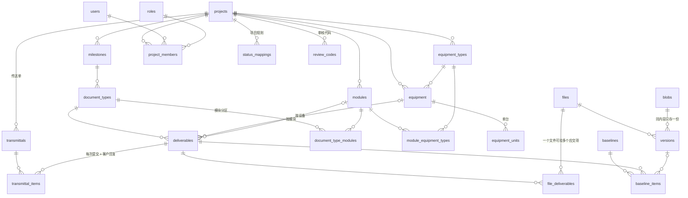

# 数据库表结构

> 对应代码：`backend/app/models.py`；迁移：`backend/alembic/versions/`。
> **改了 models.py 必须同步更新本文件**，并运行 `alembic revision --autogenerate -m "说明"` 生成迁移（测试 `test_models_match_migrations` 会检查模型和迁移是否一致）。

共 27 张业务表（另有 Alembic 自用的 `alembic_version`）。

**带全部字段的分组关系图见 [database-erd.md](database-erd.md)**（由 `backend/scripts/gen_erd.py` 自动生成，改 models.py 后在 backend 目录运行 `python scripts/gen_erd.py` 重新生成）。

## 通用约定

- 主键：自增整数 `id`；`change_logs`、`events`、`jobs` 用 BigInteger；`blobs` 以 `sha256` 为主键，`event_cursors` 以 `consumer` 为主键。
- 编号字段一律字符串：里程碑号、Submittal #（`"4.1"` ≠ `"4.10"`）、设备编号、出厂编号。
- 枚举存英文代码（VARCHAR + CHECK 约束），界面文字由前端 i18n 翻译。
- 多数表有 `created_at`、`updated_at`（带时区）。
- 配置类表有 `active` 和 `sort_order`。用过的只能停用（`active=False`，编号不复用）；没用过的（没挂文件、没进传送单和基线、发 MDL 时还不存在）可以真删除，删除前的完整内容写进变更记录（第 17F 步，见 `services/usage.py`）。
- 单租户：没有 `tenant_id` / `org_id`。

### 枚举值

| 枚举 | 值 |
|---|---|
| 应交项状态 status | `not_submitted` 未提交 · `submitted` 已提交 · `under_review` 客户审核中 · `approved` 已批准 · `revise_resubmit` 需修改重交 · `not_applicable` 不适用 |
| 责任方 responsible | `ours` 我方 · `vendor` 供应商 · `client` 客户 · `none` 无 |
| 文件来源 source | `client` 客户 · `vendor` 供应商 · `ours` 我方 |
| 匹配方式 match_type | `equals` 等于 · `contains` 包含 · `regex` 正则（均不区分大小写） |
| 变更动作 action | `create` · `update` · `delete` · `restore` |
| 任务状态 job status | `queued` · `running` · `paused` · `succeeded` · `failed` · `cancelled` |
| 要求类别 origin | `contract` 合同规定 · `client` 客户要求 · `internal` 内部要求 |
| 接受情况 acceptance | `pending` 待确认 · `accepted` 接受 · `declined` 不接受 |
| 传送单来源 transmittal source | `platform` 平台生成 · `recorded` 事后补记 · `mdl_return` MDL 导回补记 |
| 回复来源 reply_source | `manual` 手动 · `transmittal_return` 传送单导回 · `mdl_return` MDL 导回 · `file` 退回文件识别（第 12 步）· `api` 外部系统（第三版） |

## 关系总览

主线：**项目 → 里程碑 → 文件种类（可按模块分区）→ 应交项（× 设备 / × 模块 / 整个种类）→ 文件 → 版本 → 文件实体**。

提交线：**应交项 → 传送单明细（每次提交 + 客户回复）→ 推出应交项状态**；审核代码配置决定回复对应什么状态。

## 一、账号与权限

### roles 角色
角色是数据，不是写死的枚举。迁移时内置 `admin` / `member` / `readonly` 三个。

| 字段 | 类型 | 说明 |
|---|---|---|
| code | str, 唯一 | admin / member / readonly … |
| name | str | 显示名 |
| permissions | JSON 列表 | 权限码，如 `file.read`、`file.write`、`mdl.import` |
| builtin | bool | 内置角色 |
| active | bool | |

内置角色的权限（第 16 步迁移 `6ea6266fee1a` 给 admin 加了 `file.import`、`milestone.close`）：

| 角色 | 权限码 |
|---|---|
| admin（项目管理员） | project.manage、project.config、member.manage、mdl.import、equipment.import、file.import、milestone.close、file.read、file.write、file.classify、deliverable.update、export、history.read、recycle.purge |
| member（成员） | file.read、file.write、file.classify、deliverable.update、export、history.read |
| readonly（只读） | file.read、history.read |

哪个接口要哪个权限码写在 `app/services/access.py` 的规则表里（每个接口都必须有规则，没有规则的一律拒绝）。

### users 用户
| 字段 | 类型 | 说明 |
|---|---|---|
| username | str, 唯一 | |
| display_name, email | str | |
| auth_provider | str | 认证提供方，第一版只有 `local`，预留 ldap / oidc |
| external_id | str | 外部系统中的用户 ID；与 auth_provider 联合唯一 |
| password_hash | str, 可空 | 外部登录的用户为空 |
| is_sysadmin | bool | 系统级管理（管用户、建项目），与项目内角色无关 |
| locale | str | 界面语言 |
| active | bool | 停用后不能登录，已有登录立即失效 |
| failed_logins, locked_until | int, 时间 | 连续输错密码次数；输错 5 次锁定 5 分钟（第 16 步新增） |
| last_login_at, password_changed_at | 时间 | 最近登录、最近改密码（第 16 步新增） |

### auth_sessions 登录会话（第 16 步，迁移 `6ea6266fee1a`）
浏览器登录后拿到一个随机令牌（放在 HttpOnly cookie `docbase_session` 里），库里只存它的 SHA-256。

| 字段 | 类型 | 说明 |
|---|---|---|
| token_hash | str, 唯一 | 令牌的 SHA-256，不存令牌本身 |
| user_id → users | | |
| created_at, last_seen_at | 时间 | 最近使用时间最多每分钟更新一次 |
| expires_at | 时间 | 闲置 12 小时过期（`DOCBASE_SESSION_HOURS`），每次使用往后顺延 |
| revoked_at | 时间, 可空 | 退出、改密码、重设密码、停用用户时写上 |
| ip, user_agent | str | 登录时的来源，排查用 |

### project_members 项目成员
| 字段 | 类型 | 说明 |
|---|---|---|
| project_id → projects | | （project_id, user_id）唯一 |
| user_id → users | | |
| role_id → roles | | 该用户在此项目中的角色 |
| active | bool | |

## 二、项目与配置

### projects 项目
| 字段 | 类型 | 说明 |
|---|---|---|
| code | str, 唯一 | 项目编号；不进文件名，只作导出包最外层文件夹 |
| name, description | | |
| archived_at | 时间, 可空 | 不为空表示已归档（只读） |
| naming_templates | JSON | 命名模板（按设备 / 不对应设备 / 客户文件 …） |
| numbering_rules | JSON | 编号规则，如 `{"milestone_code_prefix": "M"}`：里程碑代码前缀（默认 M，即 M1、M2…） |
| client_name, contractor_name | str, 可空 | 客户名称、总包名称，印在导出 MDL 的表头（2026-10-24 新增，迁移 `4b18ca22997d`） |
| mdl_doc_no | str, 可空 | MDL 自身的文件编号；空着时导出用"项目编号-MDL" |
| mdl_prepared_by, mdl_checked_by, mdl_approved_by | str, 可空 | MDL 签字栏的编制、校核、批准人 |
| review_days | int, 可空 | 客户审核期限（天）：提交后超过这么多天没回复算客户超期未审；空着表示不限（2026-10-24 新增，迁移 `14f91edb577e`） |
| active | bool | |

`numbering_rules` 里还可以配 `transmittal_prefix`：传送单编号前缀，默认 `TR`（编号如 `P-001-TR-0001`）。

> 2026-10-24（迁移 `14f91edb577e`）删除了第一版不用的 `mdl_templates` 表和项目的 `default_mdl_template_id`。

### review_codes 审核代码
客户审完给的结论标记 → 平台状态（PRD F7.6）。**project_id 为空的是产品默认**（迁移时写入 5 个），新建项目时复制一份到项目下再按需修改；整体替换时旧的停用、留历史（2026-10-24 新增，迁移 `14f91edb577e`）。

| 字段 | 类型 | 说明 |
|---|---|---|
| project_id → projects | 可空 | 空 = 产品默认 |
| code | str | 客户用的代码，如 `1`、`A` |
| label_en, label_zh | str | 名称 |
| status | 枚举 | 对应的平台状态：已批准 / 需修改重交 / 客户审核中 / 不适用 |
| final | bool | 是否最终批准；带意见批准为否，闭环时要求拿到最终批准 |
| aliases | JSON 列表 | 识别用的别名（不区分大小写），如 `approved as noted` |
| sort_order, active | | |

默认：`1` 批准（最终）· `2` 带意见批准（不是最终）· `3` 修改重交 · `4` 不批准（→ 需修改重交）· `5` 仅供参考（→ 已批准，最终）。

### status_mappings 状态映射
MDL 上的状态文字 → 平台状态 + 责任方。**project_id 为空的是产品默认规则**（迁移时写入一套通用英文规则），新建项目时复制一份到项目下再按需修改。

| 字段 | 类型 | 说明 |
|---|---|---|
| project_id → projects | 可空 | 空 = 产品默认 |
| pattern | str | 要匹配的文字 |
| match_type | 枚举 | equals / contains / regex，不区分大小写 |
| status | 枚举 | 映射到的平台状态 |
| responsible | 枚举, 可空 | 映射到的责任方 |
| is_definite | bool | 映射是否明确；不明确时不自动下发到每台设备 |
| priority | int | 小的先匹配 |
| active | bool | |

默认规则：`approved`→已批准；`na`、`n/a`→不适用；含 `pending`→客户审核中/客户；含 `revise`、`resubmit`→需修改重交/我方；含 `missing`、`past due`→未提交/我方。

## 三、MDL 结构

### milestones 里程碑
| 字段 | 类型 | 说明 |
|---|---|---|
| project_id → projects | | （project_id, code）唯一 |
| code | str | 如 `M3`，由平台自动生成（前缀按项目编号规则，默认 M） |
| number | str | 进文件编号的部分，如 `3`，自动生成；插入、删除、调整顺序后自动补齐 |
| name, description, goal, remarks | | 来自 MDL 说明表 |
| due_date | 日期 | 里程碑截止日期 |
| closed_at | 时间, 可空 | 记录关闭的系统时间；不为空表示已关闭（不锁定，可重新打开）（2026-10-24 新增，迁移 `14f91edb577e`） |
| closed_date | 日期 | 真实关闭日期 |
| closed_by_name | str | 操作人 |
| close_basis | text | 关闭依据，如付款申请号、客户确认函；带未闭环项关闭时注明项数和原因 |
| sort_order, active | | |

### modules 模块
文件种类的分区，项目内共用。（project_id, name）唯一。字段：project_id、name、sort_order、active。

### document_types 文件种类（MDL 的一行）
| 字段 | 类型 | 说明 |
|---|---|---|
| project_id → projects | | （project_id, submittal_no）唯一 |
| milestone_id → milestones | | |
| submittal_no | str | 文本编号，`里程碑编号.序号`（如 `3.10`），由平台自动生成；`4.1` ≠ `4.10` |
| name | str | |
| category | str | 分类 |
| per_equipment | bool | 按设备 |
| per_module | bool | 按模块分区 |
| due_date | 日期 | 种类级截止日期（为空时取里程碑的） |
| content, description, purpose | text | 应含内容 / 说明 / 目的 |
| mdl_status_text, mdl_remarks, mdl_submitted_date | | MDL 上的原始状态文字、备注、提交日期 |
| origin | 枚举 | 要求类别：`contract` 合同规定 / `client` 客户要求 / `internal` 内部要求。新建时默认：还没发过 MDL 版本为 contract，发过之后为 client |
| required_date | 日期 | 要求日期：合同签订日 / 客户提出日 / 内部决定日（真实日期，不知道就空着） |
| basis | text | 要求依据：合同规定填合同条款；客户要求填客户提出要求的函件、邮件、会议纪要编号。闭环检查时，合同规定和客户要求没写依据的会提示 |
| changed_date | 日期 | 要求内容变更的日期（真实日期） |
| change_ref | text | 变更依据，如客户函件号、邮件 |
| in_client_mdl | bool | 是否列入给客户的 MDL：内部要求一律否；合同规定、客户要求默认是，可手动隐藏 |
| acceptance | 枚举, 可空 | 客户要求是否接受（只对客户要求有效，新建时默认待确认）。不接受时应交项自动为不适用，客户 MDL 里显示"不接受：依据"（2026-10-24 新增，迁移 `14f91edb577e`） |
| acceptance_ref | text | 接受 / 不接受的依据，不接受时必填 |
| variation_ref | text | 变更单号（VO / CO），要额外收费或谈工期的新增文件用 |
| keywords | JSON 列表 | 识别关键词：文件里常见的别的叫法（如 "DS"、"cut sheet"），智能投递识别用（第 12A 步新增，迁移 `40c587a2818f`） |
| sort_order, active | |

> 2026-10-24（迁移 `14f91edb577e`）删除了 `epc_reference`（合同依据，已合并进 `basis`）、`doc_count`、`knowledge_form`、`visibility`（都没有用到）。 |

### document_type_modules 文件种类-模块分区
MDL 上种类行下方"编号和名称为空、Module 有值"的行。（document_type_id, module_id）唯一。

| 字段 | 说明 |
|---|---|
| document_type_id → document_types | |
| module_id → modules | |
| mdl_status_text, mdl_remarks | 该分区在 MDL 上自己的状态文字和备注 |
| sort_order, active | |

## 四、设备

### equipment_types 设备种类
交付包的一级文件夹。（project_id, name）唯一。字段：project_id、name、sort_order、active。

### module_equipment_types 模块-设备种类对应
一个模块可对应多个设备种类，也可不对应。（module_id, equipment_type_id）唯一。字段：module_id、equipment_type_id、active。

### equipment 设备
一条 = 一个设备条目 + 台数，应交项按条目生成，不按台。

| 字段 | 类型 | 说明 |
|---|---|---|
| project_id → projects | | （project_id, tag）唯一（有编号的），**停用的也占用，编号不复用** |
| equipment_type_id → equipment_types | 可空 | |
| tag | str, 可空 | 设备编号，如 `72`；选填（2026-10-24 改，迁移 `413100fdb12b`）：没编号的用名称区分，没编号的名称不能重复（服务层保证，停用的也占用），文件名里不带编号 |
| name | str | 设备名 |
| vendor | str | 供应商 |
| quantity | int | 台数（可以几千） |
| aliases | JSON 列表 | 别名（智能投递识别用） |
| attrs | JSON | 设备清单里的其他列，原样保存 |
| sort_order, active | | |

### document_type_equipment 文件种类-设备
按设备的文件种类对应哪些设备，从项目设备清单里勾选（2026-10-23 新增，迁移 `38da8f091ff3`）。第 5 步生成应交项时，按设备的种类为每个**关联的**设备条目生成一个应交项。
（document_type_id, equipment_id）唯一。

| 字段 | 说明 |
|---|---|
| document_type_id → document_types | |
| equipment_id → equipment | |
| active | 取消勾选时只停用，再勾选时恢复 |

### equipment_units 单台
字段：equipment_id、seq（第几台）、serial_no（出厂编号）、active。**只有填了出厂编号的台才有记录**（2026-10-24 改：不再按台数自动建，迁移时删掉了没有出厂编号的占位记录）；台数减少时，超出的停用。

## 五、应交与文件

### deliverables 应交项
一个"应该有的文件"的占位：按设备的种类每台设备一个，按模块的种类每个模块一个，其余每个种类一个。
（document_type_id, equipment_id, module_id）唯一，**空值也参与比较**（PostgreSQL `NULLS NOT DISTINCT`）。

| 字段 | 类型 | 说明 |
|---|---|---|
| project_id → projects | | |
| document_type_id → document_types | | |
| equipment_id → equipment | 可空 | 按设备时有值 |
| module_id → modules | 可空 | 按模块时有值 |
| status | 枚举 | 默认 not_submitted |
| responsible | 枚举 | 默认 none |
| due_date | 日期 | 覆盖值；为空时取 种类 → 里程碑 |
| submitted_date | 日期 | |
| status_date | 日期 | 当前状态真实发生的日期（如客户批准那天），与操作时间分开；不知道就空着（2026-10-24 新增，迁移 `d4a19dac570a`） |
| status_basis | text | 当前状态的依据，如客户函件号；从 MDL 状态文字自动得出时写"来自 MDL 状态文字：…" |
| remarks | text | |
| obsolete | bool | 设备 / 模块 / 种类停用后标记，不删除 |
| external_refs | JSON 列表 | **预留（第三版）**：`[{"system": "procore", "id": "…"}]` |

### files 文件（逻辑文件）
| 字段 | 类型 | 说明 |
|---|---|---|
| project_id → projects | | |
| source | 枚举 | 客户 / 供应商 / 我方 |
| title | str | 标题；不对应设备的应交项下用它区分多个文件 |
| current_version_no | int | 当前版本号 |
| external_refs | JSON 列表 | 预留 |

**没有任何 file_deliverables 关联的文件 = 待归类。**

### file_deliverables 文件-应交项关联
一个文件可挂多个应交项，如 `3.5.72&73_…` 同时满足设备 72 和 73；存储只有一份，升版只升一次。
（file_id, deliverable_id）唯一。

### versions 版本（只增不改）
| 字段 | 类型 | 说明 |
|---|---|---|
| file_id → files | | （file_id, version_no）唯一 |
| version_no | int | V1、V2… |
| blob_sha256 → blobs | | 文件内容 |
| filename | str | 上传当时生成的文件名（历史记录）；显示和下载时按当前结构名称重新算 |
| original_name | str | 上传时的原始文件名 |
| file_date | 日期 | 文件更新日（文件名日期 → 最后修改时间 → 上传日） |
| date_source | str, 可空 | 文件日期从哪来：filename / modified / upload / manual（第 11 步新增，迁移 `1f860a88f426`） |
| uploaded_by → users, uploaded_at | | |
| uploaded_by_name | str, 可空 | 上传人名字（登录做好之前也能记，第 11 步新增） |
| parse_status, index_status, review_status | str, 可空 | **预留（第二版）**：解析 / 索引 / AI 预审，第一版始终为空 |
| recycled_at | 时间, 可空 | 进回收区的时间：供应商 / 我方文件超过最新 3 版时；被基线或未作废传送单引用的不进 |
| purged_at | 时间, 可空 | 回收区满 90 天后磁盘文件已删除的时间；记录保留（第 11 步新增）。recycled_at、purged_at 是仅有的两个会更新的字段 |
| external_refs | JSON 列表 | 预留 |

### blobs 文件实体
按 SHA-256 内容寻址，同内容只存一份。字段：sha256（主键）、size、mime_type、created_at。

### mdl_versions 客户 MDL 版本
客户 MDL 的一个版本（Rev.0、Rev.1…）：每次导出并发给客户时自动记录，保存当时"列入客户 MDL"的结构快照。只增不改（2026-10-24 新增，迁移 `bb08803011b4`）。（project_id, rev_no）唯一。

| 字段 | 类型 | 说明 |
|---|---|---|
| project_id → projects | | |
| rev_no | int | 0、1、2…，显示为 Rev.0 |
| description | text | 版本说明，如客户函件号 |
| snapshot | JSON | 结构快照：里程碑、文件种类（含分区模块名）按内部 id 记录，编号变了也能认出是同一个；只存结构，不存状态 |
| frozen_by → users, frozen_by_name | | 记录人（发 MDL 的人） |
| frozen_at | 时间 | 记录时间 |

### transmittals 传送单（提交记录）
一次提交，可带多份应交项（PRD F7.6）。只增不删，作废要写原因。（project_id, number）唯一（2026-10-24 新增，迁移 `14f91edb577e`）。

| 字段 | 类型 | 说明 |
|---|---|---|
| project_id → projects | | |
| number, seq | str, int | 编号，如 `P-001-TR-0001`，按项目顺序自动生成 |
| subject | str | 事由 |
| submitted_date | 日期, 可空 | 提交日期（真实日期）；平台生成默认今天，补记必填，MDL 导回补记时可能不知道 |
| source | 枚举 | 平台生成 / 事后补记 / MDL 导回补记 |
| method | str | 怎么交的，如 email / client_system |
| external_ref | str | 客户系统单号 |
| remarks, created_by_name | | |
| void, void_reason | bool, text | 作废及原因 |
| external_refs | JSON | **预留（第三版）**：外部系统中的对应 ID |

### transmittal_items 传送单明细 + 客户回复
传送单上的一份应交项及客户对它的回复。（transmittal_id, deliverable_id）唯一。应交项的状态跟着它最近一次提交走（不含作废的传送单）。

| 字段 | 类型 | 说明 |
|---|---|---|
| transmittal_id → transmittals | | |
| deliverable_id → deliverables | | |
| version_id → versions | 可空 | 交出去的版本里最新的一个（兼容旧数据）；全部版本见 transmittal_item_versions |
| revision | str | 客户看到的版次，如 Rev B |
| review_code, review_status, review_final | | 审核代码及当时对应的平台状态、是否最终（按当时的配置存一份，改配置不影响历史） |
| reply_date | 日期 | 客户回复的真实日期 |
| reply_ref | str | 回函号 / 客户传送单号 / 系统单号 |
| reply_comments | text | 客户意见 |
| deemed, deemed_basis | bool, text | 视为批准及合同依据（必填） |
| reply_source | 枚举 | 回复怎么录入的 |
| replied_by_name | str | 录入人 |

### transmittal_item_versions 传送单明细交出去的版本（第 15 步，迁移 `c4745ce4c7eb`）
一台设备下可以有好几份文件，一份应交项交出去的可能是几个版本。（item_id, version_id）唯一。
平台生成传送单时记这一项每份（非客户）文件的当前版本；交付包"作为提交"时记包里的版本；补记的不记。
被未作废传送单引用的版本不进回收区；闭环检查"批准后又传了新版本"和这里记的最新一版比。迁移时把原来 transmittal_items.version_id 的值复制进来。

| 字段 | 说明 |
|---|---|
| item_id → transmittal_items | |
| version_id → versions | |

### baselines 阶段基线
字段：project_id、name、description、frozen_at、frozen_by → users、frozen_by_name、counts（JSON：应交项数、有文件的、缺件的、文件数、各状态数；第 15 步新增）。只增不改，不能删。

### baseline_items 基线条目
冻结时每个应交项的状态，以及挂着的每份文件的当前版本（一份文件一行；没有文件的一行、version_id 为空）。被引用的版本不进回收区。

| 字段 | 说明 |
|---|---|
| baseline_id → baselines | |
| deliverable_id → deliverables | |
| version_id → versions | 可空：空表示冻结时缺件 |
| status, responsible | 冻结时的状态和责任方 |

## 六、系统

### change_logs 变更记录（只增不改）
| 字段 | 类型 | 说明 |
|---|---|---|
| project_id → projects | 可空 | |
| entity_type, entity_id | str | 改的是哪个对象 |
| action | 枚举 | create / update / delete / restore |
| changes | JSON | `{字段: [前, 后]}` |
| actor_id → users, actor_name | | 操作人 |
| reason | text | 原因 |
| created_at | 时间 | |

索引：(entity_type, entity_id)、(project_id, created_at)。

### events 事件（Outbox）
新版本入库、状态变更、设备变更时，与业务数据在**同一事务**里写一条。
字段：project_id、event_type、entity_type、entity_id、payload（JSON）、created_at。

### event_cursors 事件消费进度
每个消费者处理到哪条事件。第一版只有 `mirror`（共享盘镜像），第二、三版加新消费者互不干扰。
字段：consumer（主键）、last_event_id、updated_at。

### jobs 后台任务
worker 通过租约领取任务，崩溃后租约过期可被重新领取；MDL 导入预览结果也存在这里，`token` 作为预览 token。

| 字段 | 类型 | 说明 |
|---|---|---|
| token | UUID, 唯一 | 对外的任务 / 预览标识 |
| kind | str | 任务类型 |
| project_id → projects | 可空 | |
| status | 枚举 | queued / running / paused / succeeded / failed / cancelled |
| payload, result | JSON | 输入 / 输出 |
| progress, total | int | 进度 |
| attempts | int | 已尝试次数 |
| error | text | |
| lease_owner, lease_until | | 租约：谁领的、到什么时候 |
| created_by → users, created_at, started_at, finished_at | | |

索引：(status, lease_until)。

用到的任务类型（kind）：`import_scan` / `import_execute` / `import_undo`（存量导入，第 14 步）、`maintenance`（每天的例行清理）；预览 token 用的 `file_upload`、`chunked_upload`、`import_report`、`transmittal_return` 等只用 token，不进 worker。

## 七、存量导入（第 14 步，迁移 `854e155638a8`）

### import_batches 导入批次
一次导入：扫描 → 预演报告 →（改报告导回）→ 执行 →（可整批撤销）。原目录只读不改。

| 字段 | 类型 | 说明 |
|---|---|---|
| project_id → projects | | |
| source_dir | text | 源目录（服务器上的路径，须在 DOCBASE_IMPORT_ROOTS 之下） |
| description | text | 一句共用描述，识别时用 |
| status | str | scanning 扫描中 / ready 预演完成 / executing 执行中 / done 已执行 / undoing 撤销中 / undone 已撤销 / failed 扫描失败 |
| created_by_name | str | |
| job_id → jobs | 可空 | 当前的后台任务（扫描 / 执行 / 撤销），暂停、继续、看进度用 |
| counts | JSON | 各类数量：总数、各状态、各处理、各结果、待归类、疑似新设备 |
| error | text | 扫描失败的原因 |
| executed_at, undone_at | 时间 | |

### import_items 导入明细
每个文件一行；（batch_id, rel_path）唯一。

| 字段 | 类型 | 说明 |
|---|---|---|
| rel_path | text | 相对源目录的路径（/ 分隔） |
| size, modified, sha256 | | 大小、最后修改日、哈希（扫描时算，执行时再核对） |
| state | str | new 新文件 / duplicate 本批重复 / existing 平台已有 / old_version 旧版 / unreadable 读不了 |
| duplicate_of | int | 重复的是本批哪一行 |
| rec_deliverable_ids, rec_level, rec_reasons | | 识别结果：候选位置、置信度、依据 |
| suspected_equipment | str | 疑似新设备：像设备编号、项目里却没有的，只提示 |
| action | str | import 导入 / skip 跳过（报告里可改） |
| deliverable_ids | JSON | 要放的位置；空 = 待归类（报告里可改） |
| source, title | | 来源、标题（报告里可改） |
| group_key, version_rank | | 版本归并：同一位置同一标题的一组，组内第几版（1 = 最早） |
| planned_name | str | 新文件名（预演） |
| result | str | pending / done / failed / skipped；撤销后 undone，撤不了的 kept |
| file_id → files, version_id | | 导入后的文件和版本（撤销时版本会删掉，version_id 不加外键） |
| error | text | 失败 / 没撤销的原因 |
